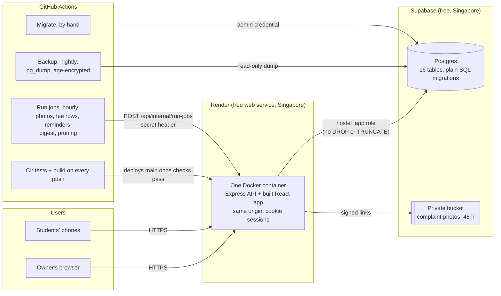
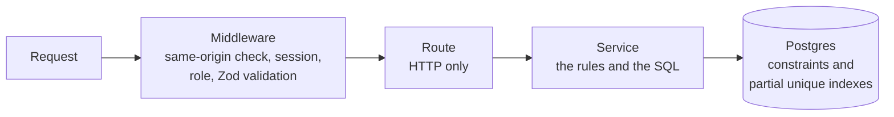

# HostelConnect

An owner-first management app for one hostel: two buildings, up to 200 students, run at
₹0 a month on free tiers.

**Live:** https://hostelconnect-o8e6.onrender.com (accounts are created by the owner; the
first visit after a quiet spell takes about a minute while the free server wakes up).

## Why it exists

Students used to raise complaints in a WhatsApp group. Everyone posted everything, the
complaints were buried in chatter, the same issue came back every day, and the owner was
pinged all day long until he locked the group. HostelConnect keeps what worked (the owner
can reach everyone) and removes what failed:

| What went wrong in the group | What the app does instead |
|---|---|
| Anyone could post to everyone | Students cannot message anyone. Only the owner publishes notices |
| Complaints were lost in chat | One short form (category, 10–500 characters, one optional photo) and one sorted list for the owner |
| The same complaint kept coming back | At most 3 open complaints per student, 2 new per day, one open per category |
| A flood of photos | One photo per complaint, compressed in the browser, deleted after 48 hours |
| Constant pings to the owner | No notification per complaint: a dashboard, and one digest a day |
| Arguments in replies | No replies. The owner changes the status and may add a one-way note |

## What it does

**The owner**

- Dashboard: students per building, open complaints, rejoin requests, fees due and
  overdue, the open return poll, storage and bandwidth use.
- Building structure: buildings first; floors, rooms and beds optional, added any time.
- Students: admission with an individual temporary password, directory and search,
  transfers with history, move-out, reactivation, password resets, a CSV import for the
  first 200.
- Complaints: filters, priority, status changes with a timeline, one-way notes.
- Announcements: publish, edit, pin, mark urgent, delete.
- Return polls after holidays ("Back after Dussehra?"): who has returned, who has not,
  who has not answered. Food counts for the cook, optionally only for those who are back.
- Fees: a cycle per student from their own joining date (joined 31 Jan: due 28 Feb,
  31 Mar, 30 Apr), marked paid by hand, with the owner's UPI ID and QR for students.
- Rejoin requests from former students.

**Students** get a deliberately small, phone-first page: raise a complaint and follow it,
read notices, answer a return poll in one tap, see their fees with the owner's UPI details,
and a notification bell (announcements, polls, complaint updates, fee reminders).

The app never touches money: students pay the owner's UPI directly, and he marks the fee
paid after checking his bank.

## Screenshots

<!-- To add: docs/screenshots/ owner-dashboard.png, owner-complaints.png,
     student-home.png (phone width), student-fees.png (phone width). -->

## Architecture



Inside the server every request takes the same path:



- **Routes** parse, validate and answer; **services** hold the rules and the SQL, so each
  rule is one function with no Express in sight; the **database** has the last word
  (for example, a partial unique index makes a second student in one bed impossible,
  even when two requests race).
- **No background process.** The free server sleeps, so scheduled work is one
  idempotent endpoint that GitHub Actions calls every hour. Each job works on what is
  due, so a late, missed or repeated call does no harm.
- **One origin.** React is served by the same Express app, so the session is an httpOnly,
  SameSite=Lax cookie with no CORS setup, and JavaScript can never read the token.

## Stack

| | |
|---|---|
| Server | Node 24, Express 5, TypeScript, `pg` with plain SQL (no ORM), Zod 4, bcrypt |
| Client | React 19, React Router 7, Tailwind CSS 4, Vite |
| Tests | Vitest, Supertest, Testing Library; server tests run against a real Postgres |
| Hosting | Render (Docker), Supabase (Postgres and storage), GitHub Actions |

## Security in short

- Two roles, checked on every request; every student query is filtered by the student's
  own id, and another student's record answers 404, not 403, so ids cannot be probed.
- Individual temporary passwords, shown once and changed at first login; bcrypt cost 12.
- The app's database role cannot drop or truncate tables; migrations use a separate
  credential that is not on the server.
- Parameterised SQL only; Zod on every body and query; same-origin check on every write.
- Uploads checked by their content, not their name; photos in a private bucket, reached
  only through 60-second signed links that stop at the 48-hour mark.
- Usage guard: photo uploads switch off at 85% of the free storage or bandwidth limit.
- Nightly backups are encrypted with `age` before they leave the workflow, because
  artifacts of a public repository can be downloaded by anyone signed in to GitHub.
- Phone numbers never appear in logs, URLs or notification text.

## Running it locally

You need Node 24, Docker and Git.

```bash
git clone https://github.com/nick10-05/HOSTELCONNECT.git
cd HOSTELCONNECT
cp .env.example .env        # works as is on your own machine; put your own JWT_SECRET in it
docker compose up -d        # Postgres 17 on localhost:5432

cd server
npm install
npm run migrate             # creates the tables and the limited hostel_app role
npm run seed:owner -- --name "Your Name" --email you@example.com   # prints a temporary password once
npm run seed:students       # optional: 200 fake students
npm run dev                 # API on http://localhost:3000

cd ../client                # in a second terminal
npm install
npm run dev                 # app on http://localhost:5173 (calls /api on port 3000)
```

Tests: `npm test` in `server` (creates and migrates its own `hostelconnect_test`
database each run) and in `client`.

## Repository layout

```
.github/workflows/  ci.yml, jobs.yml (hourly), backup.yml (nightly), migrate.yml (by hand)
client/src/         api/, auth/, owner/, student/, components/
server/migrations/  numbered SQL files
server/scripts/     migrate, seed-owner, import-students, seed-200-students, reset-owner-password
server/src/         routes/, services/, middleware/, jobs/, lib/
server/tests/       unit and integration tests
ops/                restore-drill.sh, restore-data.sh
docs/               deploy.md, RECOVERY.md, progress.md, import-template.csv
```

## Operating it

- [docs/deploy.md](docs/deploy.md): setting up Render, Supabase, secrets and backups.
- [docs/RECOVERY.md](docs/RECOVERY.md): what to do when something breaks, restoring a
  backup, the owner's lost password, rotating secrets, and a monthly checklist.
- [docs/progress.md](docs/progress.md): what was built each day, decisions, and how each
  deployment was checked.

### Free-tier limits, honestly

The free Render server sleeps after 15 idle minutes and takes about a minute to wake.
Supabase pauses a project after a week without activity (the hourly jobs and nightly
backup keep it busy) and gives no backup you can download, hence the encrypted nightly
dump. GitHub switches scheduled workflows off after 60 days without a commit. Up to a
day of changes can be lost in the worst case; the restore drill in `docs/RECOVERY.md` is
how that promise is checked.
